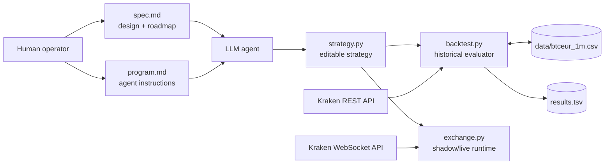
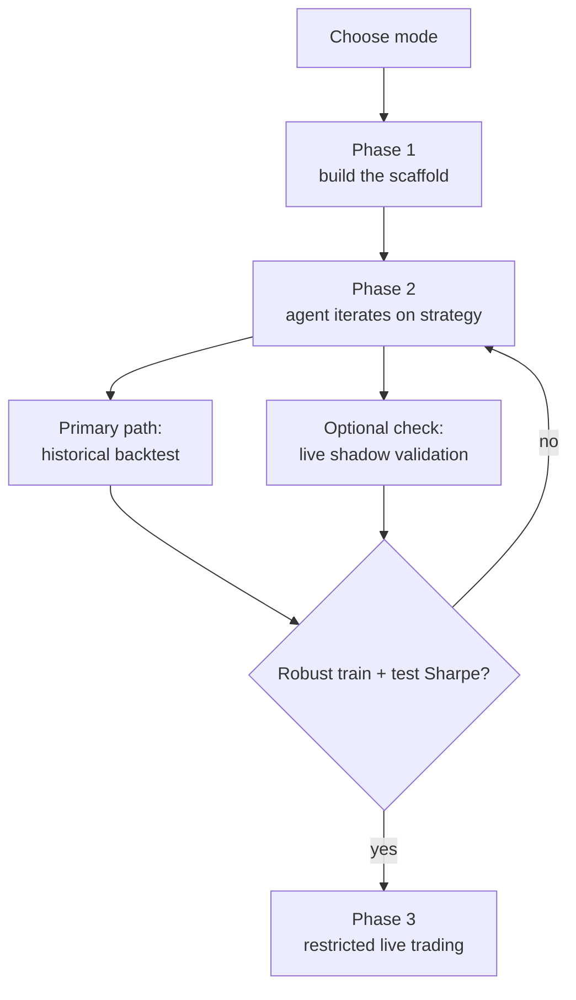

# System Architecture

This folder explains how `autotrader` works end to end, organized by the same phases defined in `spec.md`.

If you want the project rationale and roadmap source of truth, start with `spec.md`. If you want the operational view of the system, start here.

## Phase Map

- `phase-1-infrastructure.md` covers the fixed runtime scaffold: data ingestion, replay, shadow execution, metrics, and the strategy contract.
- `phase-2-agent-loop.md` covers the autonomous research loop that edits `strategy.py`, runs backtests, and decides whether to keep or discard experiments.
- `phase-3-live-trading.md` covers the planned live-trading architecture, including reconciliation, safety rails, and the shadow/live pairing.

## System Overview

## Runtime Shape

## Core Design Rule

The system is intentionally split into two layers:

- Fixed infrastructure: `backtest.py` and `exchange.py` own data ingestion, execution simulation, safety limits, and metrics.
- Search surface: `strategy.py` is the single file the agent is supposed to change.

That separation is what makes the loop auditable, repeatable, and safe enough to automate.