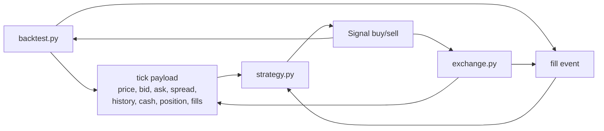
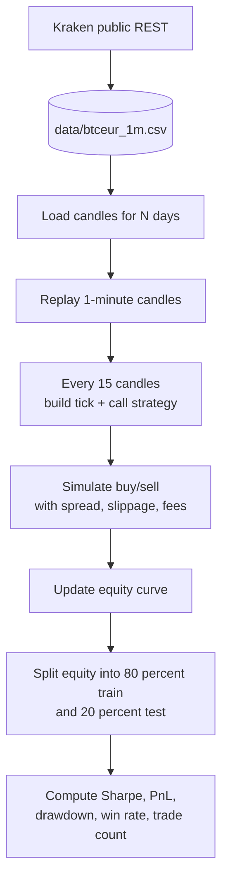
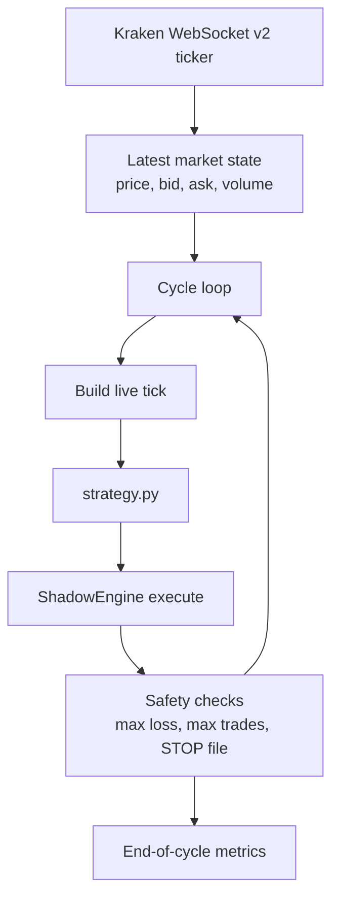

# Phase 1: Infrastructure Scaffold

Phase 1 builds the fixed machinery that every experiment depends on. The key idea is that the strategy is pluggable, but the market data, execution model, and evaluation logic are not.

## What Exists In This Phase

- `backtest.py`: downloads and caches Kraken BTC/EUR data, replays it, simulates fills, and computes metrics.
- `exchange.py`: consumes Kraken live ticker data and runs a shadow trading cycle against the same strategy interface.
- `strategy.py`: exposes `Strategy.on_tick()` and `Strategy.on_fill()`.
- `program.md`: tells the agent how to run experiments without changing the infrastructure.

## Shared Strategy Contract

Both runtimes import the same `Strategy` class and pass it a `tick` dict containing current market state, account state, and accumulated history.

## Historical Backtest Path

This is the main evaluation engine for the whole project.

## Live Shadow Path

`exchange.py` is the reality check. It uses live Kraken prices but still executes locally in shadow mode.

## Fixed Constraints

- Historical data uses Kraken public endpoints and is cached locally.
- Backtests start from `500 EUR + 0.001 BTC`.
- Execution includes synthetic spread, slippage, and Kraken-style taker fees.
- Position size is capped by infrastructure, not by the strategy.
- Metrics are computed by the infrastructure so the strategy cannot game the evaluator.

## Important Implementation Note

The project plan describes a unified 15-minute decision cadence across modes. The current code already does that in `backtest.py`, but `exchange.py` currently calls the strategy on a 1-second tick during a shadow cycle. The docs here reflect the code as it exists today, not just the intended roadmap.