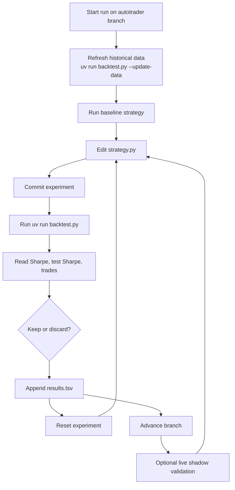
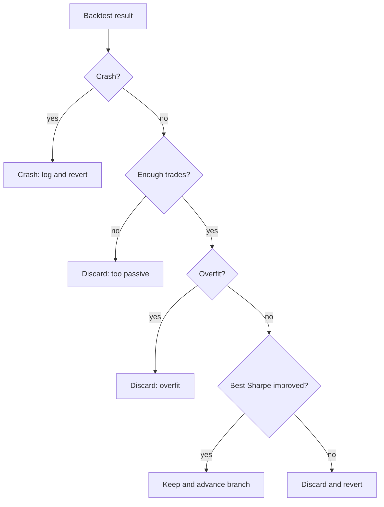
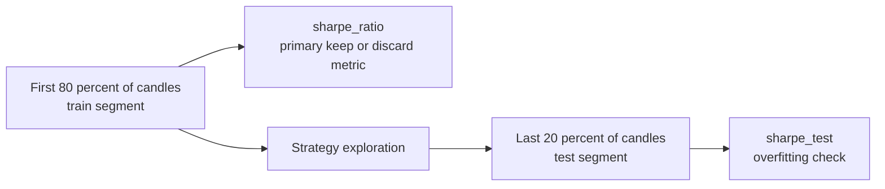

# Phase 2: Agent Loop

Phase 2 turns the scaffold into an autonomous research system. The agent is not changing the engine; it is repeatedly searching the strategy space by editing only `strategy.py`.

## Control Loop

## Why This Loop Works

- The backtest is deterministic, so the same strategy gets the same result.
- Each run completes quickly, so the agent can explore many ideas.
- The strategy surface is narrow enough to audit because changes stay in one file.
- The train/test split helps reject overfit strategies before they are promoted.

## Decision Logic

## Evaluation Timeline

The evaluator uses one continuous historical window, but scores it in two pieces.

## Files In Motion

- `strategy.py` changes every experiment.
- `run.log` captures the last backtest output.
- `results.tsv` is a persistent local ledger across runs; each row includes a date-based `run_tag` so histories remain interpretable as the backtest window moves.
- `backtest.py`, `exchange.py`, and `program.md` act as the stable operating environment.

## Promotion Rule

A strategy should only graduate from Phase 2 when it shows:

- solid train Sharpe,
- non-collapsing test Sharpe,
- enough activity to be meaningful,
- and behavior that still makes sense when checked in shadow mode.

