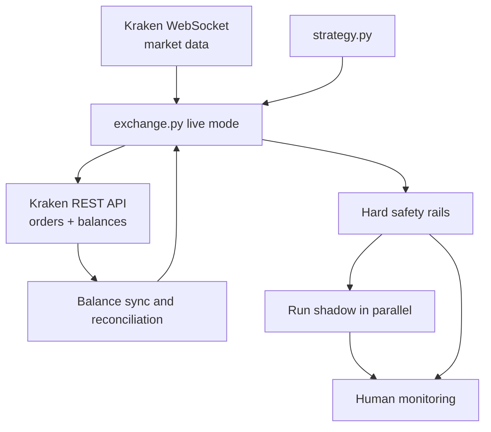
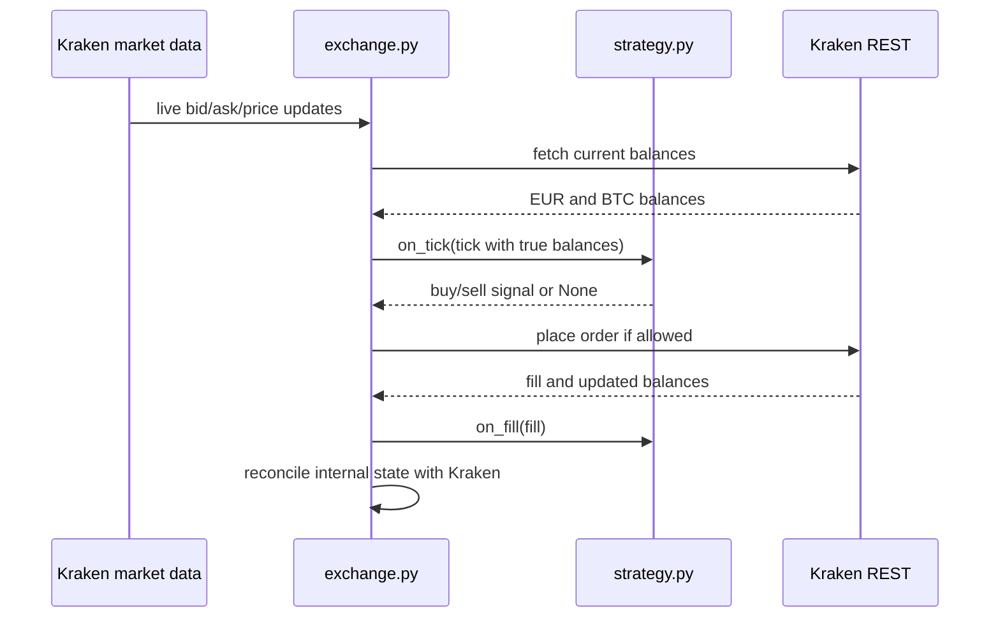
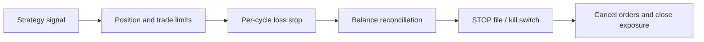

# Phase 3: Live Trading

Phase 3 is the cautious handoff from research to real execution. In `spec.md`, this phase is explicitly gated behind strong backtest results and shadow validation.

## Planned Live Architecture

## Intended Cycle

## Safety Layers

## Live-Phase Responsibilities

- Use a restricted Kraken API key with no withdrawal permission.
- Keep the live portfolio aligned with the backtest starting assumptions as closely as possible.
- Query balances after fills so the strategy sees the true account state.
- Reconcile on every decision cycle to catch drift from rounding, fees, partial fills, or manual intervention.
- Keep shadow validation running in parallel as a sanity check.

## Current Status

This phase is mostly planned rather than implemented. The repository already has the shadow runtime and safety mindset, but real order placement, balance synchronization, and full reconciliation remain future work called out in `spec.md`.