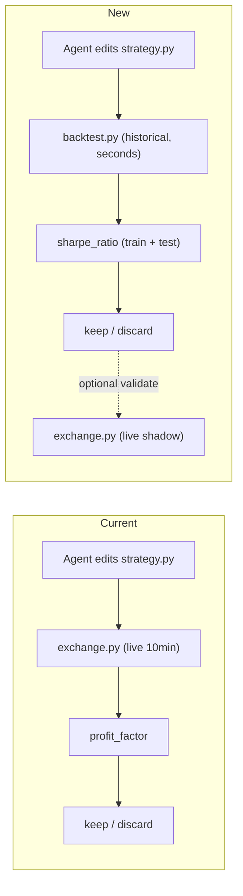
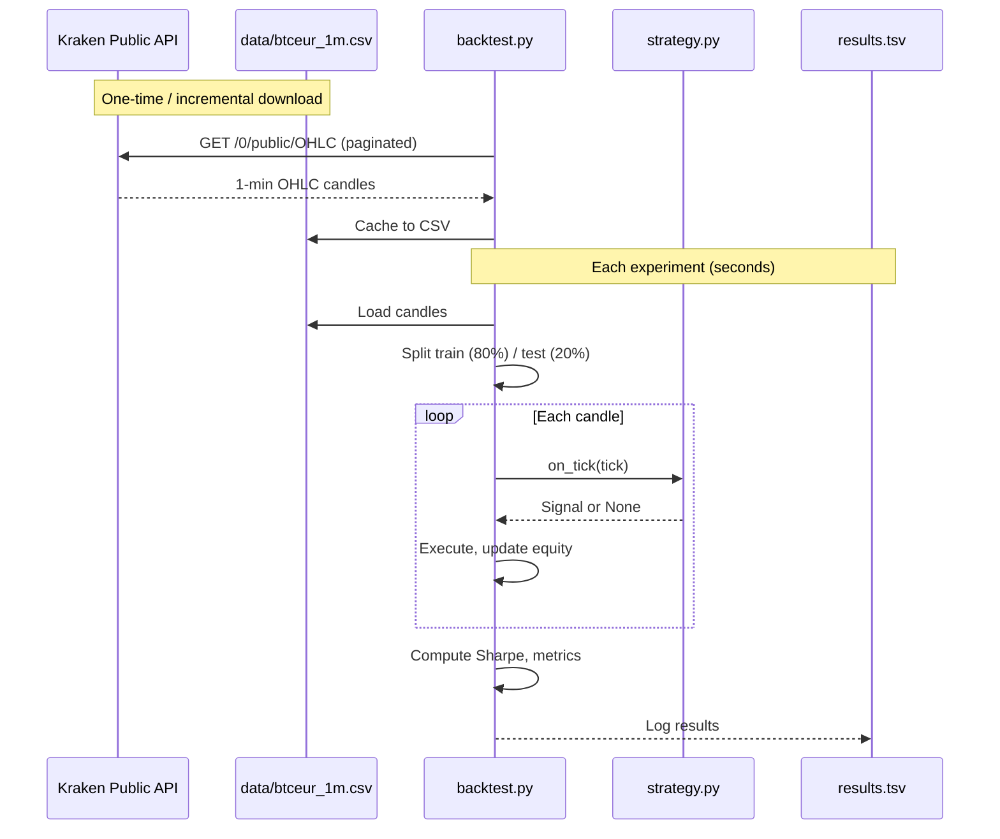

# Backtest-First Architecture Overhaul

## Problem

The current loop runs `strategy.py` against a **live 10-minute Kraken WebSocket window**, producing 5-30 trades per experiment -- statistically meaningless noise. Each experiment takes 10 real minutes, is non-deterministic, and the agent cannot distinguish signal from luck.

## Solution

Add a **historical backtesting engine** (`backtest.py`) as the primary evaluation harness. It replays months of 1-minute OHLC candles through the same Strategy interface, runs in seconds, and produces thousands of trades for statistically robust scoring. The existing live shadow mode (`exchange.py`) is retained as an optional validation step.

**Primary metric switches from profit factor to annualized Sharpe ratio**, which is well-suited now that we have enough data points.

---

## Architecture (before vs. after)




---

## File changes

### 1. NEW: `backtest.py` (read-only, agent cannot modify)

The primary evaluation harness. Responsibilities:

- **Data download**: Fetch 1-minute BTC/EUR OHLC candles from Kraken's public REST API (`GET /0/public/OHLC?pair=XBTEUR&interval=1`). Paginate using `since` parameter (720 candles/request). Cache to `data/btceur_1m.csv`. On re-run, only fetch new candles since last cached timestamp.
- **Replay engine**: Iterate candles, build a tick dict with the **exact same interface** as the live tick (see [strategy.py](strategy.py) `on_tick` signature). Synthesize `bid`/`ask` from close price +/- estimated spread. Feed `history` as growing list of close prices.
- **Execution simulation**: Reuse the same slippage/fee constants from `exchange.py` (`SHADOW_SLIPPAGE_BPS=5`, `SHADOW_FEE_BPS=26`). Own execution engine (no per-cycle trade cap since a backtest spans months).
- **Train/test split**: Hold out the last 20% of data as a test set. Report Sharpe on both. Agent optimizes train Sharpe; test Sharpe monitors overfitting.
- **Metrics**: Annualized Sharpe ratio as primary. Secondary: profit factor, total P&L, max drawdown, win rate, num trades, avg trade P&L.
- **CLI**:
  - `uv run backtest.py` -- full backtest (default 90 days)
  - `uv run backtest.py --days 30` -- shorter window
  - `uv run backtest.py --update-data` -- just download latest data

Key constants:

```python
SPREAD_BPS = 10           # estimated bid-ask spread for synthetic ticks
DEFAULT_DAYS = 90         # backtest window
TEST_FRACTION = 0.20      # hold out last 20% as test set
MINUTES_PER_YEAR = 525960 # crypto trades 24/7/365.25
```

Output format (grep-friendly, matching existing convention):

```
---
sharpe_ratio:     1.85
sharpe_test:      1.42
profit_factor:    2.150000
total_pnl_eur:    47.30
num_trades:       312
max_drawdown_eur: 8.20
win_rate:         0.583
avg_trade_pnl:    0.1517
time_in_market:   0.41
backtest_days:    90
train_days:       72
test_days:        18
mode:             backtest
```

No new dependencies -- uses `urllib.request` (stdlib) for Kraken REST API.

### 2. MODIFY: [exchange.py](exchange.py)

Minimal changes. This file remains for live shadow validation:

- Add `sharpe_ratio` as a prominently displayed metric in `print_metrics` (already computed, just change display order for consistency).
- No structural changes. Still read-only to the agent.

### 3. MODIFY: [program.md](program.md) -- major rewrite

The agent instructions change substantially:

- **Setup**: Now includes a `uv run backtest.py --update-data` step to ensure historical data is cached.
- **Primary loop**: `modify strategy.py -> uv run backtest.py > run.log 2>&1 -> grep sharpe_ratio -> keep/discard`. Runs in seconds instead of 10 minutes.
- **Primary metric**: Sharpe ratio (higher is better). Sharpe > 1.0 is good, > 2.0 is strong.
- **Keep/discard on train Sharpe**, but monitor test Sharpe for overfitting divergence.
- **Live validation**: Optional step -- periodically run `uv run exchange.py --duration 120` (2-min live cycle) to sanity-check on real market data.
- **Key differences section**: Deterministic feedback (same data = same result), fast iteration (hundreds/day), overfitting risk (new concern to watch for).
- **results.tsv format**: `run_tag	commit	sharpe_ratio	sharpe_test	pnl_eur	num_trades	status	description`

### 4. MODIFY: [spec.md](spec.md)

Update these sections:

- **Mapping table**: Add `backtest.py` row, update metric from `profit_factor` to `sharpe_ratio`, update cycle time from "10-min live" to "seconds (historical replay)"
- **Architecture**: Add `backtest.py` and `data/` to the file tree
- **Evaluation section**: Sharpe as primary metric with rationale (sufficient data points now), profit factor becomes secondary. Update the "Why profit factor over Sharpe" section to explain the reversal.
- **Experiment loop**: Rewrite to show backtest-first workflow with optional live validation
- **Resolved decisions**: Update decision #2 (metric), add new decision about historical vs. live
- **Implementation plan**: Update Phase 2 to reflect backtest-first approach

### 5. MODIFY: [README.md](README.md)

- Update description: "backtests against historical data" instead of "runs a 10-minute live-data cycle"
- Update "How it works": add `backtest.py` to the three-files description, mention `data/` cache
- Update metric: Sharpe ratio as primary
- Update quick start: `uv run backtest.py` as main command, `exchange.py` for live validation
- Update project structure listing
- Update design choices

### 6. MODIFY: [.gitignore](.gitignore)

Add `data/` directory (cached historical data should not be tracked).

### 7. MODIFY: [pyproject.toml](pyproject.toml)

No dependency changes needed (`urllib.request` is stdlib). Update description if desired.

---

## Data flow in the new system




---

## Tick interface compatibility

The Strategy class interface is **unchanged**. The tick dict passed by `backtest.py` is identical in structure to the one from `exchange.py`:

```python
tick = {
    "timestamp": candle_timestamp,          # unix timestamp of candle
    "price": close,                         # candle close price
    "bid": close - spread/2,               # synthetic bid
    "ask": close + spread/2,               # synthetic ask
    "spread": spread,                       # estimated from SPREAD_BPS
    "volume_24h": rolling_24h_volume,       # rolling sum of candle volumes
    "history": [close_0, close_1, ...],    # all previous closes
    "elapsed": seconds_since_start,         # seconds into backtest
    "position": engine.position,            # current BTC position
    "pnl": engine.unrealized_pnl(close),   # unrealized P&L
    "cash": engine.cash,                    # available EUR
    "fills": list(engine.fills),           # all fills so far
}
```

**Timescale change**: Each tick is now 1 minute (not 1 second). The current `strategy.py` has parameters tuned for 1-second ticks (e.g., `min_history = 120` = 120 seconds). The agent will need to adapt these for minute-level data (120 ticks = 2 hours). This is expected and the agent handles it naturally through the experiment loop.